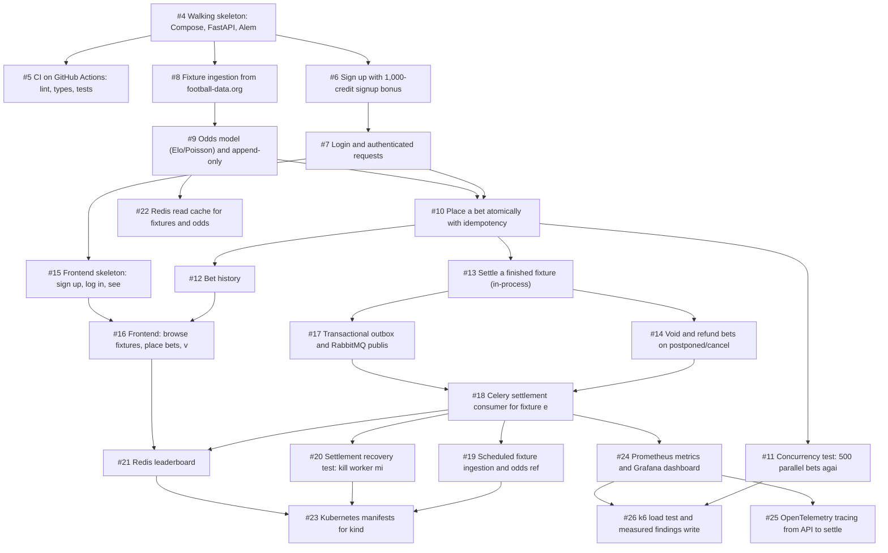

# SoccerExchange specs

One spec per ticket, generated from the GitHub Issues. **The issues are the source of truth**; if a spec and its issue disagree, update the issue and regenerate. Architecture, financial invariants and critical flows live in [CLAUDE.md](../../CLAUDE.md) and apply to every spec.

## Phase 1: Core backend (Weeks 1–4) ([#1](https://github.com/Kenneth882/play-money-sportsbook/issues/1))

Auth, accounts, ledger, fixture ingestion, odds model, bet placement with locking + idempotency, settlement, voids/refunds, bet history, integration tests, plus CI from week 1.

Settlement in this phase is triggered in-process; the transactional outbox arrives in Phase 2.

| Spec | Blocked by |
|---|---|
| [#4 Walking skeleton: Compose, FastAPI, Alembic, Testcontainers](04-walking-skeleton-compose-fastapi-alembic.md) | — |
| [#5 CI on GitHub Actions: lint, types, tests](05-ci-on-github-actions-lint-types-tests.md) | #4 |
| [#6 Sign up with 1,000-credit signup bonus](06-sign-up-with-1-000-credit-signup-bonus.md) | #4 |
| [#7 Login and authenticated requests](07-login-and-authenticated-requests.md) | #6 |
| [#8 Fixture ingestion from football-data.org](08-fixture-ingestion-from-football-data-org.md) | #4 |
| [#9 Odds model (Elo/Poisson) and append-only odds snapshots](09-odds-model-elo-poisson-and-append-only-odds.md) | #8 |
| [#10 Place a bet atomically with idempotency key](10-place-a-bet-atomically-with-idempotency-key.md) | #7, #9 |
| [#11 Concurrency test: 500 parallel bets against 1,000 credits](11-concurrency-test-500-parallel-bets-against-1.md) | #10 |
| [#12 Bet history](12-bet-history.md) | #10 |
| [#13 Settle a finished fixture (in-process)](13-settle-a-finished-fixture-in-process.md) | #10 |
| [#14 Void and refund bets on postponed/cancelled fixtures](14-void-and-refund-bets-on-postponed-cancelled.md) | #13 |
| [#15 Frontend skeleton: sign up, log in, see balance](15-frontend-skeleton-sign-up-log-in-see-balance.md) | #7 |
| [#16 Frontend: browse fixtures, place bets, view history](16-frontend-browse-fixtures-place-bets-view.md) | #12, #15 |

## Phase 2: Distributed (Weeks 5–7) ([#2](https://github.com/Kenneth882/play-money-sportsbook/issues/2))

Transactional outbox, RabbitMQ + Celery settlement, scheduled workers, recovery testing, Redis leaderboard and caching, Kubernetes manifests.

| Spec | Blocked by |
|---|---|
| [#17 Transactional outbox and RabbitMQ publisher](17-transactional-outbox-and-rabbitmq-publisher.md) | #13 |
| [#18 Celery settlement consumer for fixture events](18-celery-settlement-consumer-for-fixture-events.md) | #14, #17 |
| [#19 Scheduled fixture ingestion and odds refresh on Celery beat](19-scheduled-fixture-ingestion-and-odds-refresh.md) | #18 |
| [#20 Settlement recovery test: kill worker mid-batch](20-settlement-recovery-test-kill-worker-mid.md) | #18 |
| [#21 Redis leaderboard](21-redis-leaderboard.md) | #18, #16 |
| [#22 Redis read cache for fixtures and odds](22-redis-read-cache-for-fixtures-and-odds.md) | #9 |
| [#23 Kubernetes manifests for kind](23-kubernetes-manifests-for-kind.md) | #19, #20, #21 |

## Phase 3: Reliability/DevOps (Weeks 8–10) ([#3](https://github.com/Kenneth882/play-money-sportsbook/issues/3))

Prometheus/Grafana, OpenTelemetry tracing, k6 load tests with documented measured findings.

| Spec | Blocked by |
|---|---|
| [#24 Prometheus metrics and Grafana dashboard](24-prometheus-metrics-and-grafana-dashboard.md) | #18 |
| [#25 OpenTelemetry tracing from API to settlement](25-opentelemetry-tracing-from-api-to-settlement.md) | #24 |
| [#26 k6 load test and measured findings write-up](26-k6-load-test-and-measured-findings-write-up.md) | #11, #24 |

## Dependency graph

